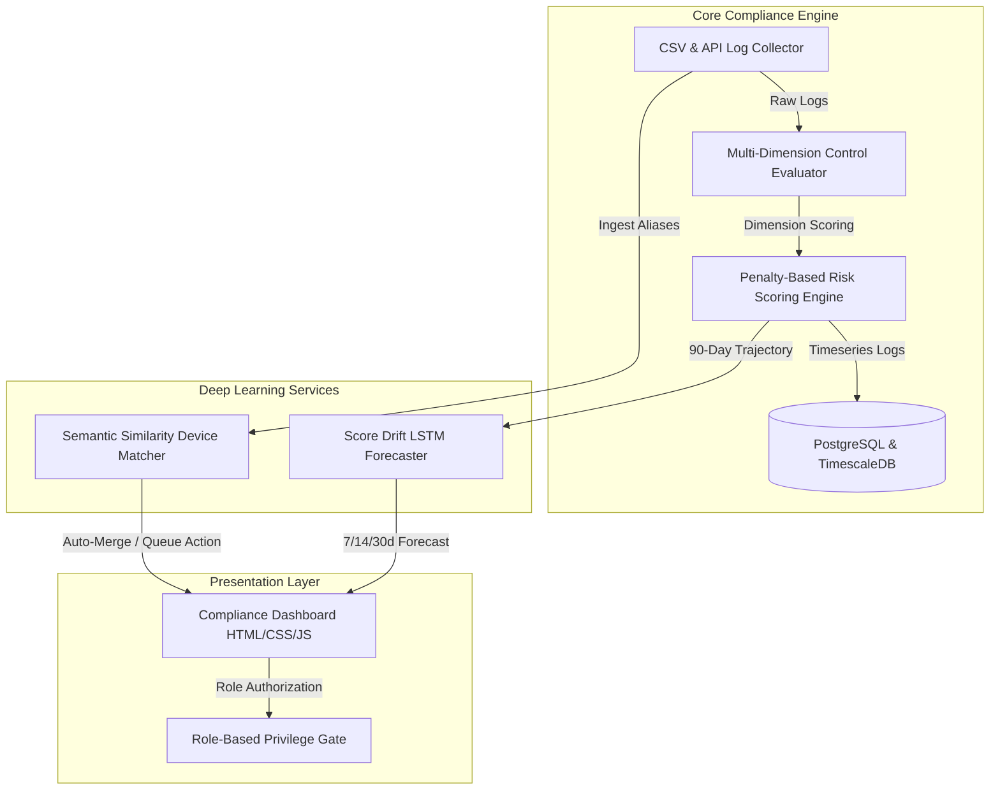

# 🛡️ EUD Compliance Dashboard

[](https://golang.org)
[](https://python.org)
[](https://pytorch.org)
[](https://timescale.com)

A premium, enterprise-grade **End-User Device (EUD) Compliance & Risk Management Platform**. It aggregates security logs, evaluates endpoint controls against strict operational frameworks (EDR, Zero Trust, Patching), calculates normalized device risk scores using an advanced penalty-based risk engine, and applies deep learning models to predict compliance score drift and resolve device duplicates.

---

## 🏛️ System Architecture

The platform is designed as a modular, container-ready multi-layered microservices system:



---

## 🌟 Key Features

### 1. 🖥️ Premium Frontend Dashboard
*   **Aesthetics**: Harmonious high-contrast dark mode tailored for Security Operations Centers (SOCs).
*   **Security Actions**: Context-isolated network mitigation controls (e.g. isolate compromised devices, trigger immediate hotfix patch deploys, force re-enrollment).
*   **Granular RBAC**: strict interface gating for four customized operational personas:
    *   **Administrator**: Full administrative & mutation capabilities.
    *   **Security Analyst**: Incident inspection, risk scoring overrides, threat tracking.
    *   **System Operator**: Safe deployment execution, telemetry collection.
    *   **External Compliance Auditor**: Restricted Read-Only ledger access.

### 2. ⚙️ Go-Based Core Compliance Engine (`/backend`)
*   **Multi-Dimension Evaluator**: Evaluates device endpoints on six critical modern vectors:
    *   `EDR` (Endpoint Detection & Response protection status)
    *   `PATCH` (OS and security updates currency)
    *   `VULNERABILITY` (Active CVE exposures)
    *   `ENCRYPTION` (BitLocker / FileVault storage locks)
    *   `NETWORK` (Zero Trust network isolation & VPN)
    *   `IDENTITY` (MFA, Active Directory status)
*   **Composite Risk Engine**:
    *   Computes weighted compliance scores ($0.0$ to $100.0$).
    *   Applies a severe **Critical Failure Penalty** multiplier ($1 - \min(C \times 0.25, 0.75)$ where $C$ is the count of critical failures) to penalize systems with complete gaps in protection.

### 3. 🧠 PyTorch & SentenceTransformers AI Services (`/ai`)
*   **Compliance Score Drift Prediction**: Uses a 2-layer Recurrent LSTM Network trained on PyTorch to ingest a 90-day time-series trajectory of device daily scores and forecast future compliance drift at **7-day**, **14-day**, and **30-day** milestones.
*   **Semantic Similarity Reconciler**: Implements a `SentenceTransformer` sentence embedding model (`all-MiniLM-L6-v2`) to compare incoming device telemetry names with existing records.
    *   `Score > 0.88` $\rightarrow$ **AUTO_MERGE** (Resolves host aliases, e.g. `DESKTOP-A1B2C3` vs `desktop-a1b2c3-main`).
    *   `Score 0.75 - 0.88` $\rightarrow$ **HUMAN_QUEUE** (Dispatches to a manual verification queue for audit review).
    *   `Score < 0.75` $\rightarrow$ **NEW_DEVICE** (Registers a completely new physical endpoint).

### 4. 🗄️ Timeseries Database Schemas (`/schemas`)
*   Optimized PostgreSQL schema blueprints.
*   TimescaleDB hypertable setups built to handle high-frequency timeseries state logs, tracking device compliance state histories efficiently over multi-year scales.

---

## 📂 Project Structure

```
.
├── ai/
│   ├── drift_predictor/       # PyTorch LSTM forecasting models
│   │   └── drift.py           
│   ├── semantic_matcher/      # SentenceTransformer MiniLM matcher
│   │   └── similarity.py      
│   ├── requirements.txt       # Python environment specifications
│   └── test_ai_services.py    # Unit tests for the AI services
├── backend/
│   ├── go.mod                 # Go module definition
│   └── pkg/
│       ├── collector/         # CSV / API data collectors
│       ├── evaluator/         # Multi-dimension compliance evaluation & risk engine
│       ├── integration/       # Alert dispatchers & webhooks
│       └── tenant/            # Tenant isolation and context management
├── frontend/
│   ├── index.html             # High-fidelity dashboard application
│   └── style.css              # Custom dark-theme stylesheet
├── schemas/
│   ├── postgres/              # Relational core table schemas
│   └── timescale/             # Hypertable definitions for compliance history log
└── .gitignore                 # Safe, comprehensive exclude list
```

---

## 🚀 Setup & Execution Guide

### 1. Frontend
Simply load the high-fidelity index inside any modern browser:
```bash
# Double-click or serve using a static server
cd frontend
npx browser-sync start --server --files "*.html, *.css"
```

### 2. Backend (Go)
Navigate to `/backend` and compile or test the core evaluation packages:
```bash
cd backend
# Run core evaluator & risk engine tests
go test ./pkg/evaluator/...
```

### 3. AI Services (Python)
Setup the virtual environment and test the PyTorch & SentenceTransformer capabilities:
```bash
cd ai
# Setup virtual environment
python -m venv .venv
source .venv/bin/activate  # On Windows: .venv\Scripts\activate

# Install dependencies
pip install -r requirements.txt

# Execute validation tests (drift prediction & semantic mapping)
python test_ai_services.py
```

---

## 🛡️ Operational Compliance Tiers

The composite risk score translates into four corporate threat vectors:

| Score Range | Risk Level | Operational Response |
| :--- | :--- | :--- |
| **85 - 100** | 🟢 **LOW** | Normal operations, continuous remote collection. |
| **65 - 84** | 🟡 **MEDIUM** | Warn user, queue low-priority patches for next maintenance window. |
| **40 - 64** | 🟠 **HIGH** | Immediate notification, enforce VPN-only access. |
| **0 - 39** | 🔴 **CRITICAL** | Zero-trust isolation enforced: restrict network access until remediated. |
