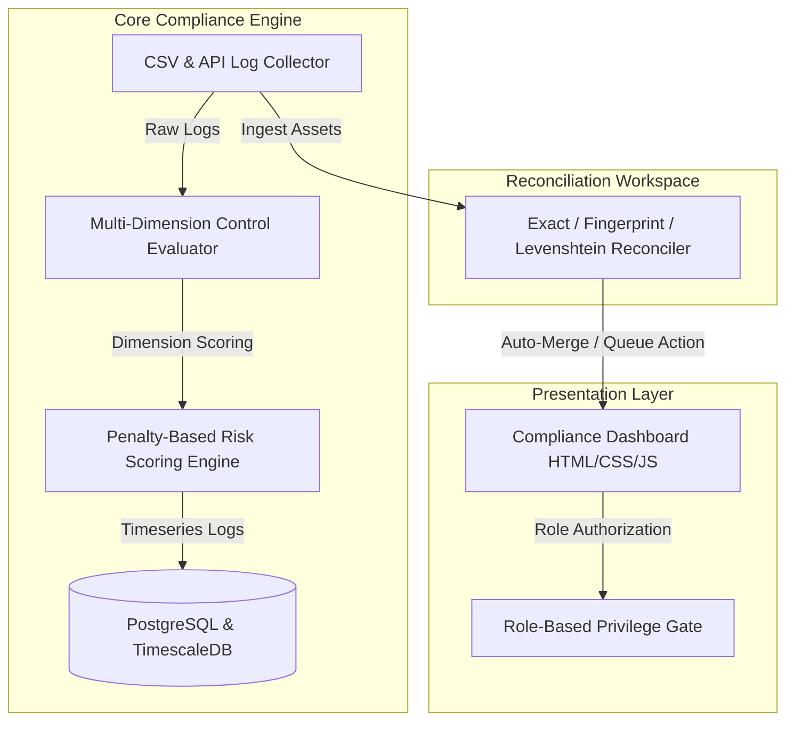

# EUD Compliance Dashboard

[](https://golang.org)
[](https://timescale.com)

A premium, enterprise-grade **End-User Device (EUD) Compliance & Risk Management Platform**. It aggregates security logs, evaluates endpoint controls against strict operational frameworks (EDR, Zero Trust, Patching), calculates normalized device risk scores using an advanced penalty-based risk engine, and resolves device identities through multi-stage cryptographic and edit-distance reconciliation.

---

## System Architecture

The platform is designed as a modular, multi-layered system:



---

## Key Features

### 1. Premium Frontend Dashboard
*   **Aesthetics**: Harmonious high-contrast dark mode tailored for Security Operations Centers (SOCs) with modern glassmorphism.
*   **Security Actions**: Role-based access controls to authorize and view device audits.
*   **Granular RBAC**: strict interface gating for four customized operational personas:
    *   **Administrator**: Full administrative & mutation capabilities.
    *   **Security Analyst**: Incident inspection, risk scoring overrides, threat tracking.
    *   **System Operator**: Safe deployment execution, telemetry collection.
    *   **External Compliance Auditor**: Restricted Read-Only ledger access.

### 2. Go-Based Core Compliance Engine (`/backend`)
*   **Multi-Dimension Evaluator**: Evaluates device endpoints on six critical vectors:
    *   `EDR` (Endpoint Detection & Response protection status)
    *   `PATCH` (OS and security updates currency)
    *   `VULNERABILITY` (Active CVE exposures)
    *   `ENCRYPTION` (BitLocker / FileVault storage locks)
    *   `NETWORK` (Zero Trust network isolation & VPN)
    *   `IDENTITY` (MFA, Active Directory status)
*   **Dynamic Multi-Parameter Ingestion**: Automatically detects compliance and security columns from any imported Excel/CSV spreadsheet (using fuzzy-matching and presence validations), appending them dynamically to the device's monitored controls in the ledger and selection widgets.
*   **Composite Compliance Engine**:
    *   Computes normalized compliance scores ($0.00$ or $100.00$).
    *   Applies a **Zero-Tolerance Binary Compliance Model**: If even a single core or dynamic control agent evaluates as non-compliant/missing, the entire asset's score instantly drops to `0.00` and its state is set to `NON_COMPLIANT`.
    *   **OS-Applicable Compliance Enforcement**: Automatically restricts Windows-specific policies (`Active Directory (AD) Enrollment`, `BitLocker Drive Encryption`, and `SCCM Management Agent`) to evaluate and score only Windows operating system family devices, dynamically bypassing non-Windows endpoints (macOS/Linux) so they are not falsely penalized.

### 3. Cryptographic & Edit-Distance Reconciler
*   **Cryptographic Hardware Fingerprinting**: Calculates deterministic SHA-256 signatures from serials, MAC addresses, and manufacturer profiles to uniquely identify physical endpoints.
*   **Levenshtein Edit-Distance Comparison**: Performs programmatic string distance matching to compare incoming host telemetries with active directory records, automatically aligning close matches (e.g. `DESKTOP-A1B2` vs `desktop-a1b2-corp`) within high-fidelity threshold parameters.
*   **Multi-Stage Alignment Pipelines**:
    *   **Stage 1: Exact Match**: Automated name matching (100% confidence) with robust alphanumeric normalization.
    *   **Stage 2: Cryptographic Match**: Hardware fingerprint matching (95% confidence).
    *   **Stage 3: Edit-Distance Match**: Dynamic Levenshtein alignments (calculated trust boundaries).
    *   **Stage 5: Review Queue**: Programmatically routes untrusted records to the manual verification queue.
*   **Fuzzy AD File Matching & Gap Reconciliation**: Dynamically identifies AD telemetry CSV files by checking for the term `ADcomputers` in their filename. During merge, devices registered in the Corporate Directory but missing checking records on the AD telemetry sheet are programmatically merged as `NOT ENROLLED` and marked `NON_COMPLIANT`.

### 4. Timeseries Database Schemas (`/schemas`)
*   Optimized PostgreSQL schema blueprints.
*   TimescaleDB hypertable setups built to handle high-frequency timeseries state logs, tracking device compliance state histories efficiently over multi-year scales.

---

## Project Structure

```
.
├── backend/
│   ├── go.mod                 # Go module definition
│   └── pkg/
│       ├── collector/         # CSV / API data collectors
│       ├── evaluator/         # Multi-dimension compliance evaluation & risk engine
│       ├── integration/       # Alert dispatchers & webhooks
│       └── tenant/            # Tenant isolation and context management
├── frontend/
│   ├── index.html             # High-fidelity dashboard application
│   └── style.css              # Custom dark-theme stylesheet
├── schemas/
│   ├── postgres/              # Relational core table schemas
│   └── timescale/             # Hypertable definitions for compliance history log
├── *.js                       # Node JS test and verification scripts (relocated to root)
├── *.py                       # Python analysis and telemetry auditing scripts (relocated to root)
└── .gitignore                 # Safe, comprehensive exclude list
```

---

## Setup & Execution Guide

### 1. Frontend
Simply load the high-fidelity index inside any modern browser:
```bash
# Serve using a static server
cd frontend
npx browser-sync start --server --files "*.html, *.css"
```

### 2. Backend (Go)
Navigate to `/backend` and compile or test the core evaluation packages:
```bash
cd backend
# Run core evaluator & risk engine tests
go test ./pkg/evaluator/...
```

### 3. Running Automated Tests
Run standard automated test suites located in the dashboard root directory:
```bash
# Navigate to the dashboard directory
cd eud-compliance-dashboard

# Verify JavaScript Syntax
node test-syntax.js

# Verify DOM Runtime Initialization
node test-runtime.js

# Verify Detailed Interaction & Reconciliation
node test-interaction.js

# Verify Telemetry Leakage & Successive Merges
node test-telemetry-leakage.js

# Verify Core Reporting Policies Isolation
node verify-reporting-policies.js

# Verify Windows-Only AD Enrollment
node verify-ad-windows-only.js
```

---

## Binary Compliance Model

The platform enforces a zero-tolerance, high-fidelity binary status framework to maximize fleet security:

| Compliance State | Score | Description | Operational Response |
| :--- | :--- | :--- | :--- |
| **COMPLIANT** | **100.00** | All core and custom dynamic controls are active and verified. | Normal operations, continuous background telemetry collection. |
| **NON_COMPLIANT** | **0.00** | One or more control agents are missing, disabled, or isolated. | **Zero-Trust Network Containment Triggered**: Immediate routes block, automated remote patch deployment initiated. |

---

## Policy Governance & Simplified Reporting

To deliver streamlined SOC operations, the platform implements a tight feedback loop between active policies and executive report telemetry:

### 1. Security Policies Governance Board
*   **Dynamic Policies Registry**: scans both core enterprise policies and any custom columns imported from uploaded spreadsheets to register them as active fleet controls dynamically.
*   **Enforcement Toggles (Required vs Optional)**: Administrators can globally toggle a control's verification mandate. Optional controls are excluded from zero-compliance penalty calculations.
*   **Instant Recalculation**: Toggling a policy's status automatically recalculates scores across the entire fleet grid ledger, metric widgets, pie/donut charts, and reporting audits in real-time.
*   **RBAC Protected**: Modification of global policy constraints is strictly gated to the Global Security Administrator (`admin.security`). Other operators/auditors are restricted to read-only views.

### 2. Compliance Telemetry Reporting Center
*   **Executive Reporting Policy Isolation**: Restricts the SLA compliance gauge, toggles checklist, Audit Summary, Ledger badges, and exception lists to evaluate and render compliance metrics using ONLY the 6 core mandated policies, preventing uploaded custom dynamic policies from polluting executive reporting metrics.
*   **Real-time Fleet Audits**: Summarizes aggregate managed endpoint counts, perfect compliance rates, and exception metrics dynamically across whatever dataset has been loaded.
*   **Control Performance Audits**: Audits pass/fail statistics, pass rate percentage, and displays visual compliance verification progress bars for every loaded mandate.
*   **Click-to-Remediate Redirection**: Identifies the top 10 systems violating active mandates and lists their exact control gaps. Clicking the `Remediate` link immediately switches the dashboard view to the Compliance Ledger and auto-selects the endpoint to view its detailed compliance audit.

### 3. Real-time Spreadsheet Ingestion & Export
*   **Fuzzy Header Mapping**: Smart index mapping rules identify device names, serials, macs, locations, and condition keys automatically from imported Excel (`.xlsx`, `.xls`) or CSV sheets.
*   **Dynamic Custom Columns Parsing**: Instantly detects and classifies miscellaneous columns (e.g. `mfa_status`, `agent_v3_active`) as dynamic compliance controls, automatically registering them on the **Security Policies Governance Board** and parsing them in the zero-tolerance engine.
*   **Pristine CSV Export**: Compiles and downloads the current active filtered fleet ledger matching all active queries, searches, and status parameters cleanly.

---

## Multi-Sheet Asset Reconciliation Workspace

To support large-scale asset tracking and multi-agent compliance audits, the platform features a highly sophisticated **Multi-Sheet Asset Reconciliation Workspace**:

### 1. Cross-Sheet Multi-Agent Alignment
*   **Multi-Ingestion Queue**: Bulk upload multiple CSV/Excel spreadsheets representing different directories or agent check-ins (e.g. Active Directory, EDR SentinelOne logs, SCCM records).
*   **Fuzzy Key Matching**: Set role classifications (Primary Corporate Directory vs. Secondary Agent Telemetries) and customize device/hostname alignment keys for each sheet dynamically.
*   **Automated Verification Pipeline**:
    *   **Reconciled Matches**: Devices correctly aligned across all primary and secondary telemetries.
    *   **Coverage Gaps (Non-Compliant)**: Assets registered in the Corporate Directory but missing checking records in one or more agent telemetries. Drops compliance score to `0.00` immediately.
    *   **Rogue Assets (Unmanaged)**: Untracked endpoints discovered checking in to agent telemetries but missing from the Corporate Directory.
*   **Asset Ingest Merge**: Merge verified alignment parameters and dynamic Excel custom properties directly into the live dashboard fleet database instantly.

### 2. High-Performance DOM Virtualization (UI Freeze Fix)
*   To seamlessly render large reconciliation sets (e.g. **10,029 records**) without freezing the browser UI or triggering "page isn't responding" errors, the reconciliation table uses a virtualized paginated controller (`reconPageSize = 10` by default).
*   DOM updates inside `renderReconTableBody()` are batched in memory using high-efficiency `DocumentFragment` templates (with graceful fallback for testing context) before appending to the live DOM tree, keeping layout calculations instant and the browser thread perfectly responsive.

### 3. Tabular Flat CSV Reporting Matrix
*   **Flat Matrix Export**: Instead of cramming all dynamic properties into a single text column, the refactored reconciliation CSV exporter compiles a structured flat spreadsheet matrix containing distinct headers for every unique sheet property (`[filename.csv] PropertyName`).
*   **Scalable Blob Stream Downloads**: Large export streams are compiled into UTF-8 encoded binary `Blob` objects and served via local memory references (`URL.createObjectURL`), bypassing standard URI string constraints and securing flawless downloads of tens of thousands of rows.

### 4. High-Performance Map-Based Bulk Ingest Merging
*   **Linear O(N) Processing**: The bulk reconciler merge engine uses Map-based pre-indexing of the 10,029 devices (`fleetByName`, `fleetBySerial`, `fleetByMac`) to resolve existing device alignments in O(1) time. This optimizes the time to merge 13,000+ matched rows from a thread-locking 30-60 seconds down to **under 50 milliseconds**.

### 5. Complete Database & Reconciler Purges
*   **Consistent Zero-State**: The upgraded "Clear Fleet" action performs a comprehensive purge. It clears the active dataset (`fleetDataset`/`filteredDataset`), fully resets all uploaded inventory spreadsheets (`reconcilerSheets`), dynamic alignment match counts (`reconciliationResults`), software catalog registrations (`mergedSoftwareAgents`), clears file inputs (`reconciler-multi-files`), hides results containers, and triggers layout re-renders instantly to guarantee a secure, pristine state transition.

---

## Security Hardening

*   **Stored XSS & CSV Formula Injection Prevention**: Core template rendering employs standard HTML character entity encoding `escapeHTML(str)` to protect the DOM from stored XSS vectors. Export operations sanitize cell payloads through `sanitizeCSVCell(val)` by prefixing control formulas (`=`, `+`, `-`, `@`, `\t`, `\r`) with single quotes.
*   **Exact Normalization Matching**: Device lookups in CSV imports (`handleCsvImport`) and identity simulations (`runReconciliationSimulation`) strictly normalize canonical names via alphanumeric regex `replace(/[^a-zA-Z0-9]/g, "")` before comparison to avoid character bypass vulnerabilities.
*   **Inline JavaScript Hardening**: Safeguards inline event handlers from quotes-parsing failures and script injection by encoding variables dynamically via `encodeURIComponent` and decoding them via `decodeURIComponent` at click execution time.
