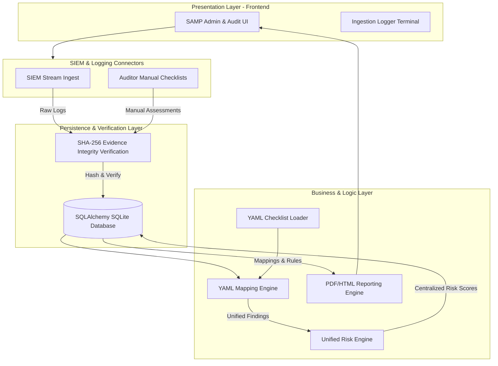

# EUD Compliance & Reconciliation Dashboard

[](https://www.python.org/)
[](https://developer.mozilla.org/en-US/docs/Web/Guide/HTML/HTML5)
[](https://www.docker.com/)

A premium, enterprise-grade **End-User Device (EUD) Compliance & Risk Management Platform**. It aggregates security telemetry, evaluates endpoint controls against Operational frameworks (EDR, Zero Trust, BitLocker, Patching), calculates normalized device risk scores, and resolves device identities through multi-stage cryptographic and edit-distance reconciliation.

The platform is designed to run in air-gapped or locked-down corporate environments with **zero external python dependencies**, leveraging native XML/zip parsers to inspect Excel spreadsheets on the backend.

## System Architecture

The platform uses a secure FastAPI backend backed by SQLAlchemy and SQLite to host the database registry, evaluate YAML compliance mappings, ingest verified SIEM event streams, run environment-aware risk scaling calculations, and serve manual audit checklist overrides.



---

## Key Features

### 1. Premium Frontend Dashboard & Portals
*   **Official AM/NS INDIA Brand Typography**: Montserrat and Inter display fonts configured to match the corporate block logo layout and tight letter-spacing (`-0.05em`).
*   **Dynamic Sidebar & Logo Routing**: Logo is clickable to return to the hub, and the "Gateway Portal" menu item is dynamically hidden once an active tool is launched.
*   **Professional Corporate Aesthetics**: Deep dark slate backgrounds (`#0f172a` to `#020617` gradient) and sleek, minimalist card/borders replacing unneeded decorative elements.
*   **Executive Policy Isolation**: Restricts the SLA dial gauge and exceptions to evaluate compliance using strictly the **6 core mandated policies** (Active Directory, BitLocker, Zscaler, Nessus, SentinelOne, and SCCM).

### 2. SIEM Ingest Stream Pipeline
*   **Connector Feeds**: Ingests event logs from Active Directory, Nessus, EDR, and network gateways.
*   **Non-Repudiation Registry**: Signs evidence log records immediately on ingest using a cryptographic **SHA-256** hashing function (`SHA-256(raw_log + assessment_id + collected_at)`).
*   **Background Simulation**: Features a background simulation logging terminal to stream and register simulated system events.

### 3. Centralized Risk Engine
*   **Multi-Dimensional Scoring**: Configurable severity weights (High, Medium, Low) that calculate normalized overall compliance risk metrics.
*   **Environment-Aware Risk Scaling**: Adjusts ratings based on host environments (Production carries full severity, UAT is downgraded by 1 tier, and Development is downgraded by 2 tiers, never scaling below LOW for failures).

### 4. SAMP Auditor Board & Manual Checklists
*   **NIST Control Mappings**: Fully maps manual controls CTRL-011 through CTRL-015 (RBAC checks, LDAP account disablement, audit completeness, alerting, and logout session revokes).
*   **Manual Overrides & Evidence Registry**: Allows auditors to pass/fail checklist items, add detailed verification findings, and sign evidence blocks cryptographically.

### 5. Multi-Sheet Asset Reconciliation
*   **Identity Resolution**: Aligns Corporate Directory rows with EDR logs using normalized names, MACs, and serial keys.
*   **Output Categorization**: Automatically groups reconciler assets into Matches, Coverage Gaps, and Rogue Assets.

---

## Project Structure

```
.
├── backend/
│   └── app/
│       ├── main.py            # FastAPI Application bootstrap
│       ├── database.py        # SQLAlchemy SQLite engine configuration
│       ├── security.py        # SSRF checks, URL validation, and cryptographic hash verification
│       ├── assessment/        # Assessment/Findings database schemas, services & routers
│       ├── checklist/         # YAML checklist loaders and policy evaluation interpreters
│       ├── evidence/          # Immutable evidence store & SHA-256 validation endpoints
│       ├── risk/              # Risk calculator, weights engine, and environment modifiers
│       ├── siem/              # Event logger ingestion and simulation endpoints
│       └── reports/           # HTML and PDF compliance report generators
├── frontend/
│   ├── index.html             # High-fidelity single-page compliance console
│   ├── style.css              # Custom minimalist stylesheet
│   ├── logo.png               # Brand logo
│   └── favicon.png            # Tab icon
├── tests/                     # Automated JS and Python test suite scripts
│   ├── test_api.py            # API routing integration checks
│   ├── test_mapping_engine.py # YAML parsing mapping validations
│   ├── test_risk_engine.py    # Environment risk modifier assertions
│   ├── test_security.py       # SSRF and URL validation checks
│   ├── test-interaction.js    # Front-end reconciliation logic simulations
│   └── ...                    # Other automated DOM and telemetry leakage validations
├── Dockerfile                 # ECS/AWS App Runner container config
├── Procfile                   # Elastic Beanstalk configuration
└── README.md                  # System overview and manual
```

---

## Hosting & Setup Guide

### 1. Hosting Locally / Corporate Network (FastAPI)

Ensure Python 3.10+ is installed. Install requirements and run the FastAPI server using Uvicorn:

```bash
python -m uvicorn backend.app.main:app --host 127.0.0.1 --port 8080
```
*Open browser at: `http://127.0.0.1:8080/index.html`.*

### 2. Hosting on AWS (Future Compatibility)

The server automatically prioritizes the `PORT` environment variable injected by cloud providers.

*   **AWS App Runner / ECS Fargate**:
    Deploy using the root `Dockerfile`. Configure the build and point the start command to:
    ```bash
    python -m uvicorn backend.app.main:app --host 0.0.0.0 --port 8080
    ```
*   **AWS Elastic Beanstalk**:
    Zip the project files and upload to a Python platform application. Elastic Beanstalk will automatically use the root `Procfile` to start the application.

---

## Running Verification Tests

Run the standard automated test suites inside the `tests/` directory to verify backend endpoints, YAML parsing rules, CSS theme selectors, and frontend reconciliation logic:

```bash
# Run backend Python pytest suite
python -m pytest tests

# Verify JavaScript Syntax in index.html script tags
node tests/test-syntax.js

# Verify DOM Runtime Boot
node tests/test-runtime.js

# Verify Detailed Interaction & Reconciliation Flows
node tests/test-interaction.js

# Verify Telemetry Leakage & Successive Merges
node tests/test-telemetry-leakage.js

# Verify Multi-Attribute Identity Resolution with Distinct Keys
node tests/test-distinct-merge-keys.js

# Verify Custom Telemetry Table rendering
node tests/verify-details-table.js

# Verify Core Reporting Policies Isolation
node tests/verify-reporting-policies.js

# Verify Windows-Only AD Enrollment applicability
node tests/verify-ad-windows-only.js

# Verify Mismatched Alignment Keys Prevention
node tests/test-mismatched-keys-prevention.js

# Verify Rogue Assets Management workflows
node tests/test-rogue-actions.js
```
