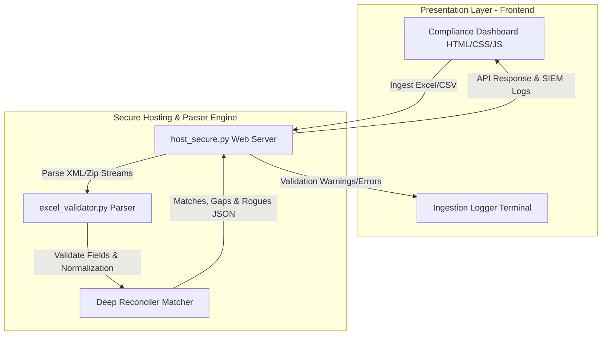

# EUD Compliance & Reconciliation Dashboard

[](https://www.python.org/)
[](https://developer.mozilla.org/en-US/docs/Web/Guide/HTML/HTML5)
[](https://www.docker.com/)

A premium, enterprise-grade **End-User Device (EUD) Compliance & Risk Management Platform**. It aggregates security telemetry, evaluates endpoint controls against Operational frameworks (EDR, Zero Trust, BitLocker, Patching), calculates normalized device risk scores, and resolves device identities through multi-stage cryptographic and edit-distance reconciliation.

The platform is designed to run in air-gapped or locked-down corporate environments with **zero external python dependencies**, leveraging native XML/zip parsers to inspect Excel spreadsheets on the backend.

---

## System Architecture

The platform uses a secure, lightweight Python backend to serve static assets and offload intensive data validation and cross-sheet reconciliation tasks:



---

## Key Features

### 1. Premium Frontend Dashboard
*   **SOC Aesthetics**: Harmonious, high-contrast dark mode tailored for Security Operations Centers (SOCs) with clean glassmorphism and real-time SLA dial gauges.
*   **Role-Based Access Control (RBAC)**: Interface gating for four customized operational personas:
    *   **Administrator**: Full administrative and data mutation capabilities.
    *   **Security Analyst**: Incident inspection, risk overrides, threat containment triggers.
    *   **System Operator**: Telemetry collection and manual device registration.
    *   **Compliance Auditor**: Restricted read-only ledger access.
*   **Executive Policy Isolation**: Restricts the SLA dial gauge, checklists, and exception lists to evaluate and render compliance metrics using strictly the **6 core mandated policies** (Active Directory, BitLocker, Zscaler, Nessus, SentinelOne, and SCCM), preventing custom dynamic policies from polluting executive SLA reports.

### 2. Zero-Dependency Python Validation Engine (`excel_validator.py`)
*   **Native XML/Zip XLSX Parser**: Direct extraction and parsing of `.xlsx` files without requiring heavy libraries like `pandas` or `openpyxl`.
*   **Fuzzy Header Matching**: Auto-detects device name, serials, MACs, states, and compliance columns from raw spreadsheets.
*   **Field Format Validation**: Validates hostname syntax, MAC address formatting (IEEE 802.3), IPv4 patterns, last login dates, and normalized state values.
*   **OS-Applicable Policy Filters**: Automatically restricts Windows-specific policies (`Active Directory Enrollment`, `BitLocker Drive Encryption`, and `SCCM Management Agent`) to evaluate and score only Windows devices, bypassing macOS/Linux systems.

### 3. Multi-Sheet Asset Reconciliation
*   **Identity Resolution**: Aligns Corporate Directory rows with secondary agent outputs using normalized names, MACs, and serial keys.
*   **Output Categorization**:
    *   **Matches**: Device successfully aligned across all telemetries.
    *   **Coverage Gaps**: Device registered in the Corporate Directory but missing checking records in agent logs (triggers immediate non-compliance rating).
    *   **Rogue Assets**: Untracked devices discovered checking into agent logs but missing from the Corporate Directory.
*   **Virtual Table Rendering**: Handles huge datasets (10,000+ rows) without browser lockups using a fast, memory-batched paginated viewer.
*   **Clean Fleet Grid**: The main assets table displays key identity attributes, location information, and active condition states, with the redundant compliance status badge column removed to keep focus on dynamic telemetry values.

---

## Project Structure

```
.
├── frontend/
│   ├── index.html             # High-fidelity dashboard application
│   ├── style.css              # Custom dark-theme stylesheet
│   ├── logo.png               # Corporate sidebar branding logo
│   └── favicon.png            # Browser tab icon
├── tests/                     # Automated test suite scripts
│   ├── test-distinct-merge-keys.js
│   ├── test-interaction.js
│   ├── test-mismatched-keys-prevention.js
│   ├── test-rogue-actions.js
│   ├── test-runtime.js
│   ├── test-syntax.js
│   ├── test-telemetry-leakage.js
│   ├── verify-ad-windows-only.js
│   ├── verify-details-table.js
│   └── verify-reporting-policies.js
├── host_secure.py             # Secure HTTPS/HTTP Python server (AWS compatible)
├── excel_validator.py         # Native XML/zip Excel parser & validation engine
├── Dockerfile                 # Docker container config (for AWS App Runner / ECS)
├── Procfile                   # Elastic Beanstalk process deployment config
├── .gitignore                 # Exclude list for credentials and local cache files
└── README.md                  # System overview and deployment guide
```

---

## Hosting & Setup Guide

### 1. Hosting Locally / Corporate Network (Python)

Ensure Python 3.10+ is installed. Run the secure Python server from the project root:

*   **Option A: HTTPS Mode (Recommended for Corporate Networks)**
    Automatically generates or loads SSL certificate/key files and starts a hardened server on port `4430`:
    ```bash
    python host_secure.py --generate-cert
    ```
    *Open browser at: `https://127.0.0.1:4430` (or `https://<YOUR_LOCAL_IP>:4430` for network devices).*

*   **Option B: HTTP Mode (Unencrypted / Local Testing)**
    Bypasses SSL wrapping to serve on port `8080` bound to all interfaces for network hosting:
    ```bash
    python host_secure.py --no-ssl --port 8080 --bind 0.0.0.0
    ```

### 2. Hosting on AWS (Future Compatibility)

The server automatically prioritizes the `PORT` environment variable injected by cloud providers.

*   **AWS App Runner / ECS Fargate**:
    Deploy using the root `Dockerfile`. Configure the build and point the start command to:
    ```bash
    python host_secure.py --no-ssl --bind 0.0.0.0 --port 8080
    ```
*   **AWS Elastic Beanstalk**:
    Zip the project files and upload to a Python platform application. Elastic Beanstalk will automatically use the root `Procfile` to start the application.

---

## Running Verification Tests

Run the standard automated test suites inside the `tests/` directory to verify syntax, security policies, and reconciliation logic:

```bash
# Verify JavaScript Syntax in index.html script tags
node tests/test-syntax.js

# Verify DOM Runtime Boot
node tests/test-runtime.js

# Verify Detailed Interaction & Reconciliation Flows
node tests/test-interaction.js

# Verify Telemetry Leakage & Successive Merges
node tests/test-telemetry-leakage.js

# Verify Multi-Attribute Identity Resolution with Distinct Keys
node tests/test-distinct-merge-keys.js

# Verify Custom Telemetry Table rendering
node tests/verify-details-table.js

# Verify Core Reporting Policies Isolation
node tests/verify-reporting-policies.js

# Verify Windows-Only AD Enrollment applicability
node tests/verify-ad-windows-only.js

# Verify Mismatched Alignment Keys Prevention
node tests/test-mismatched-keys-prevention.js

# Verify Rogue Assets Management workflows
node tests/test-rogue-actions.js
```
