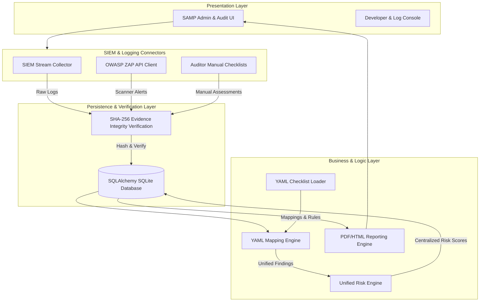

# Implementation Plan - Integrated SIEM, Centralized Risk Engine & Security Audit Management Platform (SAMP)

This document outlines the detailed architecture, integration points, security controls, development phases, and validation strategies for combining a SIEM event ingestion pipeline, a centralized environment-aware Risk Engine, and the Security Audit Management Platform (SAMP).

---

## Unified System Architecture

The integrated system merges three primary operations:
1. **SIEM Event Pipeline**: Direct ingest of logging data (Active Directory, Nessus, EDR, Zscaler) into an immutable evidence store.
2. **Decoupled Risk Engine**: Multi-dimensional risk scoring with environment-aware downgrades and audit mapping logic.
3. **SAMP Core**: Relational database persistence, YAML-driven policy evaluations, cryptographic evidence signing, and automated web scanners.



---

## Architectural Decisions & Rationale

### 1. Unified Relational Schema (SQLAlchemy + SQLite)
* **Rationale**: To establish complete traceability between raw SIEM streams, active vulnerability alerts, manual audit results, and generated compliance reports.
* **Security Controls**: Parameterized queries prevent SQL injections. OS-level permissions safeguard the file-based SQLite database.
* **Extensibility**: By standardizing on SQLAlchemy, the backend can migrate to PostgreSQL or AWS RDS with zero code changes.

### 2. SIEM Ingest Connector with Cryptographic Verification (SHA-256)
* **Rationale**: To guarantee non-repudiation of audit evidence. Logs are hashed upon ingest using `SHA-256(raw_data + assessment_id + collected_at)`.
* **Security Controls**: Any database modification or tampering is instantly flagged during log retrieval when hash verification runs.

### 3. Decoupled, Environment-Aware Risk Engine
* **Rationale**: Avoids hardcoding vulnerability ratings. Calculations are centralized rather than delegated to third-party scanners.
* **Scoring Rules**:
  * **Production**: Full severity assignment (High, Medium, Low).
  * **UAT/QA**: Severity downgraded by 1 level (e.g., HIGH -> MEDIUM).
  * **Development**: Severity downgraded by 2 levels (e.g., HIGH -> LOW), never below LOW for failures.
  * Passed checks resolve to `PASS`.

### 4. Rule-Based YAML Mapping Interpreter
* **Rationale**: Standardizes checks without modifying code. Compliance teams can modify mapping rules in a simple YAML configuration instead of modifying Python files.
* **Security Controls**: The yaml parser is locked down via `yaml.safe_load`. RCE risks are eliminated by avoiding the use of `eval()` or dynamic execution.

### 5. SSRF and Redirect Protection
* **Rationale**: Safeguards corporate internal networks during automated spidering or Nessus checks.
* **Security Controls**: Target domains are pre-resolved to IP addresses, validated against a private subnet blacklist (e.g., `127.0.0.0/8`, `10.0.0.0/8`, `169.254.169.254`), and redirects are strictly verified before execution.

---

## Proposed Project Directory Structure

```
backend/
├── app/
│   ├── __init__.py
│   ├── main.py                 # FastAPI Application bootstrap
│   ├── database.py             # SQLAlchemy configuration
│   ├── config.py               # Env/Configuration loader
│   ├── security.py             # SSRF Protection, URL Validation, Hash Verification
│   ├── assessment/
│   │   ├── models.py           # Assessment SQLAlchemy model
│   │   ├── schemas.py          # Pydantic validation schemas
│   │   ├── services.py         # Assessment orchestrator
│   │   └── router.py           # REST endpoints
│   ├── evidence/
│   │   ├── models.py           # Immutable raw evidence store
│   │   ├── services.py         # SHA-256 Hashing & verification
│   │   └── router.py
│   ├── checklist/
│   │   ├── checklist.yaml      # Definitions of the 15 controls
│   │   ├── mappings.yaml       # Evaluator rules (regex, exists, equals)
│   │   ├── services.py         # Rule Evaluator mapping engine
│   │   └── router.py
│   ├── risk/
│   │   ├── services.py         # Risk Engine with environment modifiers
│   │   └── router.py
│   ├── siem/
│   │   ├── services.py         # Ingestion adapters for AD, Nessus, EDR, Zscaler
│   │   └── router.py
│   ├── reports/
│   │   ├── services.py         # Report Builder (PDF, HTML, JSON)
│   │   └── router.py
│   └── scanners/
│       ├── automated_checks.py # Direct HTTP header, SSL, HSTS, Cookie audits
│       ├── zap_client.py       # OWASP ZAP Client wrapper (with mock support)
│       └── router.py
├── tests/
│   ├── conftest.py
│   ├── test_security.py        # SSRF and URL validation tests
│   ├── test_mapping_engine.py  # Mappings engine evaluation validation
│   ├── test_risk_engine.py     # Environment-aware risk downgrades validation
│   └── test_api.py             # FastAPI endpoint routing integration
├── requirements.txt
└── README.md
```

---

## 15 Predefined Audit Controls (`checklist.yaml`)

The interpreter will map raw SIEM logs and active scan evidence to the following 15 controls:

| Code | Title | Validation Type | Severity | Description / Pass Criteria / Recommendation |
|---|---|---|---|---|
| **CTRL-001** | HTTP Strict Transport Security | AUTOMATED | HIGH | HSTS header check. Must contain `max-age` of at least 1 year (31536000s). |
| **CTRL-002** | Secure Cookie Flags | AUTOMATED | MEDIUM | All session cookies must have `HttpOnly` and `Secure` flags, and `SameSite` set to Strict/Lax. |
| **CTRL-003** | Content Security Policy | AUTOMATED | HIGH | CSP header check. Must exist and not allow wildcard `default-src *`. |
| **CTRL-004** | X-Content-Type-Options | AUTOMATED | LOW | Header must be set to `nosniff`. |
| **CTRL-005** | Cache-Control Policies | AUTOMATED | LOW | Sensitive pages must set `Cache-Control: no-store, no-cache`. |
| **CTRL-006** | Secure Password Forms | AUTOMATED | HIGH | Login forms must submit passwords via HTTPS POST, not HTTP or GET. |
| **CTRL-007** | Cookie Path Restriction | AUTOMATED | LOW | Cookies must specify a restricted path rather than defaulting to `/` where applicable. |
| **CTRL-008** | Server Banner Disclosure | AUTOMATED | LOW | Headers must not leak server versions (e.g., `Server` or `X-Powered-By`). |
| **CTRL-009** | Active Scan Vulnerabilities | SCANNER | HIGH | Target must not have High or Critical alerts in active scanning. |
| **CTRL-010** | Unencrypted HTTP Fallback | AUTOMATED | HIGH | Validates that HTTP requests are automatically redirected to HTTPS. |
| **CTRL-011** | Role-Based Access Control | MANUAL | HIGH | Auditors verify RBAC authorization checks are enforced on endpoints. |
| **CTRL-012** | Inactive Account Disable | MANUAL | MEDIUM | Auditors verify LDAP/AD automated deactivation policies are active. |
| **CTRL-013** | Audit Log Completeness | MANUAL | HIGH | Auditors verify access, modifications, and security events are logged. |
| **CTRL-014** | Security Alerting | MANUAL | MEDIUM | Auditors verify alerts are raised on anomalous login attempts. |
| **CTRL-015** | Logout Session Kill | MANUAL | HIGH | Auditors verify backend session tokens are revoked upon logout. |

---

## Detailed Integration Phases

### Phase 1: Persistence Setup
* Create database tables for assessments, findings, log entries, and raw evidence.
* Build Pydantic validation schemas.
* Set up SHA-256 hashing functions inside the `evidence` service to sign evidence upon registration.

### Phase 2: SIEM Event Connector
* Create ingestion endpoints `/api/siem/ingest` to receive logs from Active Directory, Nessus, EDR, and network gateways.
* Store logs as signed records in the `evidence` database.

### Phase 3: Rule Evaluation & Mappings Engine
* Develop a YAML mapping interpreter inside `checklist/services.py`.
* Map SIEM logs and active scans to the 15 controls using defined check conditions (e.g., `exists`, `regex_match`).

### Phase 4: Environment-Aware Risk Engine
* Develop the centralized Risk calculator.
* Incorporate environment variables (`Production`, `UAT`, `Development`) to downgrade severities appropriately.

### Phase 5: Web Scanners & SSRF Guard
* Implement automated HTTP checks for security headers and cookies.
* Configure pre-resolution domain checking and IP blacklists to block SSRF requests.
* Wire the OWASP ZAP API client with an automatic Mock fallback for headless execution.

### Phase 6: Reporting & Manual Checklists
* Implement endpoints to allow auditors to PASS/FAIL manual controls (e.g. CTRL-011 through CTRL-015).
* Write HTML, PDF (via `reportlab`), and JSON generators to output comprehensive compliance reports.

---

## Verification Plan

### Automated Tests
1. **SSRF protection**: Assert private range target IPs are blocked.
2. **Evidence Immutability**: Validate that modified database rows fail SHA-256 signature verification.
3. **Cheklist Mapping Engine**: Inject mock logs/alerts and assert correct Findings are evaluated.
4. **Risk Modifier**: Test that Development and UAT environments correctly scale down ratings.

### Manual Verification
1. Run local dev server: `uvicorn app.main:app --reload`.
2. Access Swagger documentation at `http://127.0.0.1:8000/docs` to test SIEM log ingestion.
3. Trigger a manual audit assessment and confirm generation of a signed compliance PDF.
