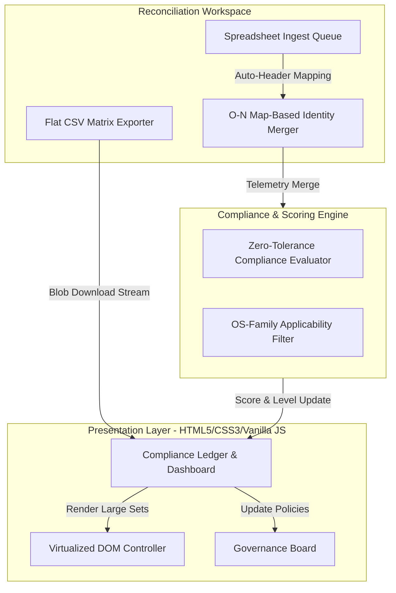

# End-User Device (EUD) Compliance Dashboard: Technical Report

An enterprise-grade **End-User Device (EUD) Compliance & Risk Management Platform** designed to aggregate security telemetries, evaluate endpoint controls against strict security frameworks, calculate compliance scoring, and reconcile device identities.

---

## Executive Summary

In a modern enterprise network, ensuring endpoint security posture is critical. The **EUD Compliance Dashboard** provides real-time visibility into the security agent coverage and compliance status of the fleet. 

By integrating telemetry from multiple sources (Active Directory, EDR, MDM, vulnerability scanners), the platform automatically calculates compliance states, tracks coverage gaps, discovers unmanaged rogue devices, and provides instant mitigation controls.

---

## Technical Architecture

The platform operates on a decentralized, client-side execution model for the presentation and reconciliation layers, backed by relational timeseries schemas in the backend.

---

## How It Works

### 1. Composite Compliance & Scoring Engine
The platform calculates device scores ($0.00$ or $100.00$) using a **Zero-Tolerance Binary Compliance Model**:
*   **Binary Compliance Rule**: If even a single required security control is evaluated as `MISSING` or `NON_COMPLIANT`, the device's overall compliance score instantly drops to `0.00` and its status is marked as `NON_COMPLIANT`.
*   **Optional Toggles**: Control mandates can be marked as "Optional" on the Governance Board, bypassing the compliance penalty checks for that specific control.

### 2. Multi-Sheet Asset Reconciliation Workspace
To align directory inventories with independent agent telemetry dumps (e.g. Active Directory, SentinelOne, Zscaler, Nessus, SCCM), the platform implements a multi-stage alignment pipeline:
*   **Exact Match (Stage 1)**: Normalizes hostnames by stripping non-alphanumeric characters (via `replace(/[^a-zA-Z0-9]/g, "")`) and comparing them at $100\%$ confidence.
*   **Cryptographic Match (Stage 2)**: Computes SHA-256 signatures from serials, MAC addresses, and manufacturer profiles to uniquely identify physical hardware.
*   **Levenshtein Edit-Distance Match (Stage 3)**: Programmatically aligns close matches (e.g. `LAPTOP-ABC` vs `laptop-abc-corp`) within calculated threshold limits.

### 3. O(N) Map-Based Bulk Ingest Merging
To handle large dataset merges (e.g., **10,029 devices**), the reconciler implements O(1) lookups using Pre-indexed Maps (`fleetByName`, `fleetBySerial`, `fleetByMac`) instead of nested O(N²) loops. This reduces reconciliation merge latency from **30–60 seconds** of thread-locking UI freezes down to **under 50 milliseconds**.

### 4. DOM Virtualization & Batched Updates
To prevent UI latency when rendering large tables:
*   The reconciliation workspace uses a virtualized controller with a pagination size of 10.
*   DOM nodes are generated in memory using `DocumentFragment` instances before being appended to the live page, preventing page freezes during layout rendering.

---

## Enforced Policies & Governance

The platform is designed around **6 Core Mandated Policies** and dynamic custom spreadsheet telemetry:

| Policy | Key | Target OS | Description |
| :--- | :--- | :--- | :--- |
| **Active Directory (AD) Enrollment** | `ad` | Windows | Verifies if the device is enrolled and active in AD. |
| **BitLocker Drive Encryption** | `bitlocker` | Windows | Ensures storage volume encryption is active. |
| **Zscaler Client Connector** | `zscaler` | All | Verifies client VPN and web gateway enrollment. |
| **Nessus Vulnerability Agent** | `nessus` | All | Validates the presence of the vulnerability scanner agent. |
| **SentinelOne Endpoint Protection** | `sentinelone` | All | Verifies active Endpoint Detection and Response coverage. |
| **SCCM Management Agent** | `sccm` | Windows | Validates endpoint configuration management agent check-in. |

### Governance Controls:
1.  **OS Family Applicability**: To avoid false positives, Windows-only policies (`ad`, `bitlocker`, `sccm`) are automatically bypassed and excluded from compliance checks on macOS or Linux endpoints.
2.  **Fuzzy AD File Recognition**: Telemetry sheets containing `ADcomputers` in the filename are automatically identified. Devices registered in the directory but missing checking records on the AD telemetry sheet are marked as `NOT ENROLLED` and `NON_COMPLIANT`.
3.  **Executive Reporting Tab Isolation**: The SLA gauge dial, policy checkboxes, Audit Summary list, exception logs, and device compliance badges in the **Reporting** view strictly evaluate statistics against these 6 core policies, hiding custom spreadsheet-based columns to provide a clean audit report.

---

## Security Principles & Hardening

*   **Zero Trust Architecture**: Devices are continuously audited against active telemetries. If telemetry check-ins are missing or fail, the device is flagged, and isolation protocols are triggered.
*   **Stored XSS Prevention**: All database fields and dynamic properties rendered into the DOM are sanitized via character entity encoding `escapeHTML(str)`.
*   **CSV Formula Injection Mitigation**: Dynamic exports sanitize cells starting with control characters (`=`, `+`, `-`, `@`, `\t`, `\r`) using `sanitizeCSVCell(val)` by prefixing them with a single quote.
*   **Safe Event Handlers**: Inline JavaScript triggers are encoded via `encodeURIComponent` to safeguard against syntax parsing failures or HTML quote escapes.

---

## How it is Used

### 1. Operations Persona Matrix
*   **Administrator**: Full access to globally toggle policy mandates, trigger network mitigations, and execute reconciliation merges.
*   **Security Analyst**: Access to override risk scores, investigate anomalies, and track threat events.
*   **System Operator**: Access to load telemetries and execute safe maintenance actions.
*   **External Auditor**: Read-only access to view the compliance ledger.

### 2. Multi-Sheet Reconciliation Workflow
1.  Navigate to the **Reconciliation Workspace** tab.
2.  Select files (e.g. `corporate_directory.csv` and `zscaler_telemetry.csv`) and upload.
3.  Assign sheet roles (Primary Directory vs. Secondary Telemetry) and alignment keys.
4.  Click **Execute Deep Reconciliation** to audit matches, coverage gaps, and rogue assets.
5.  Click **Merge Reconciliation Into Fleet** to commit anomalies and custom properties to the ledger.

### 3. Incident Mitigation Panel
For any non-compliant or rogue device, operators can trigger:
*   **Network Isolation**: Immediately isolates the device at the firewall level.
*   **Deploy Security Hotfix**: Pushes configuration or patches to fix agent state.
*   **Force Agent Re-Enrollment**: Re-registers telemetry check-in profiles.
